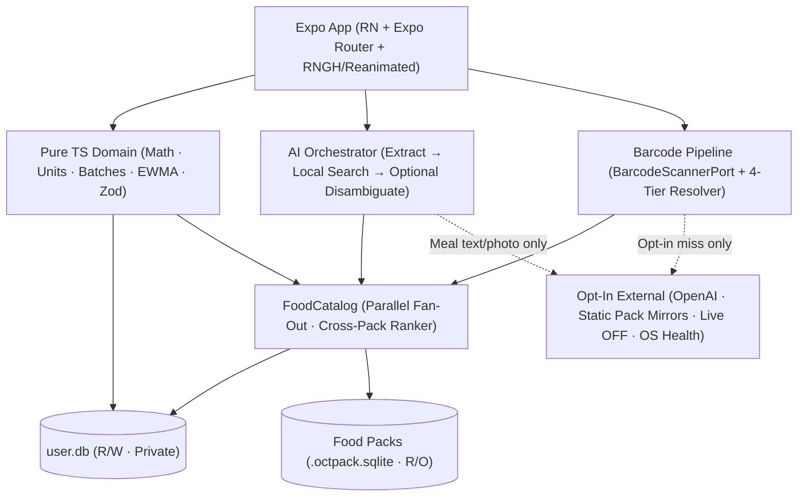

# OpenCalorieTracker — Architecture

Status: proposed for review.  
References: [PRD_V1.md](./PRD_V1.md) · [MARKET_RESEARCH.md](./MARKET_RESEARCH.md) · [MARKET_RESEARCH_ADDENDUM.md](./MARKET_RESEARCH_ADDENDUM.md) · Doop canvas (`App` / Icon Rail)

> **Scope revision (23 November 2026).** V1 is mobile-only: iPhone, Android phone, iPad, Android tablet, Android foldable and iPhone Duo. Three items are out of V1: the desktop app and its Tauri v2 spike, optional cross-device sync (including sync hosting and sync E2EE), and the MyFitnessPal / competitor importer. Expo Web remains a developer and QA preview only, never a shipped target. Storage is local-first and single-device (`user.db` plus read-only `.octpack.sqlite` food packs), with versioned JSON backup/restore and CSV export.

---

## 1. System at a Glance



### Core Invariants
- **Mobile-only, offline-first, zero required backend.** Manual tracking, search, recipes, and export work with no network or account. V1 targets iPhone, Android phone, iPad, Android tablet, Android foldable and iPhone Duo; no desktop or hosted-web client.
- **Deterministic math only.** AI never calculates final nutrition or writes to `user.db`; it proposes drafts that require explicit user confirmation.
- **Immutable history.** Confirmed entries store nutrition snapshots + source/version; editing recipes, custom foods, or packs never rewrites past logs.
- **`NULL` ≠ `0`.** Unknown fiber/micronutrients stay `NULL` (shown as partial); unlogged meals/days stay empty (`—`), never `0 kcal`.
- **Source energy preserved.** Store source `kcal` directly (do not force `4P + 4C + 9F`). Never apply a global mass↔volume density.
- **Single device, portable data.** `user.db` on the device is the only live copy; versioned JSON backup/restore and CSV export are the movement path. No sync tables, no sync account, no E2EE in V1.

---

## 2. Stack & Module Boundaries

Start as **one Expo app** with enforced folder boundaries (no multi-package monorepo until a second runtime actually needs shared packages).

| Area | Choice | Notes |
| --- | --- | --- |
| App shell | React Native + Expo (CNG / Dev Build) | Required for SQLite FTS5, native OAuth loopback, FOSS camera decoder, OS Health |
| Mobile targets (all of V1) | iOS: iPhone, iPad, iPhone Duo · Android: phone, tablet, foldable | One codebase, responsive and fold-aware layouts; no desktop or shipped web build |
| Navigation & Gestures | `expo-router`, RNGH, Reanimated, `expo-haptics` | Tap and hold-and-swipe share one commit action |
| Storage | `expo-sqlite` (FTS5 enabled) | Single source of truth; Zustand only when shared ephemeral UI state is needed |
| Expo Web | Developer / QA preview only | Not a shipped target: Expo Web SQLite lacks FTS5 by default, so it can only exercise non-FTS surfaces |

*Dropped 23 November 2026:* the Tauri v2 + Expo Web desktop candidate and its WebView/SQLite spike. Desktop is out of V1 scope.

```text
src/
├── domain/        # Pure TS (NO react-native/expo imports): math, units, batches, EWMA, import/export
├── storage/       # user.db DDL, versioned migrations, atomic repos, JSON/CSV round-trip
├── catalog/       # FoodSourceAdapter, FoodSourceRegistry, pack mounting, cross-pack ranker
├── ai/            # Provider interface, ChatGPT OAuth / BYO key, SSE client, draft proposals
├── barcode/       # BarcodeScannerPort, GTIN normalization, 4-tier resolver, label capture
└── ui/            # Tokyo Night tokens, Icon Rail primitives, screens (Today/Library/History/Progress/Settings)
tools/
└── pack-builder/  # FOSS CLI: CSV/JSON/Parquet → validated .octpack.sqlite
```

---

## 3. Data Layer: `user.db` vs. Pluggable Food Packs

Separate writable personal data (`user.db`) from read-only **Food Packs** (`.octpack.sqlite`). Mount each pack with its own read-only `expo-sqlite` handle queried in parallel (`Promise.all`)—avoids SQLite's 10-DB `ATTACH` limit, write-lock contention, and license mixing.

### `user.db` (Private · Read/Write)
| Table | Purpose | Key Rules |
| --- | --- | --- |
| `diary_days` | Per-date completeness | `complete \| partial \| none` |
| `diary_entries` | Drafts + confirmed logs | UUIDv7, idempotency key, frozen nutrient snapshot, `provenance_kind`, `source_pack_id/id/version`, `portion_certainty` (`stated\|estimated`), `[min_g, max_g]`, `draft_state` |
| `custom_foods` | User foods + barcode overrides | `basis` (`per_100g\|per_100ml\|per_serving`), optional barcode link |
| `recipes` & `recipe_ingredients` | Reusable templates | Versioned; edits affect new logs/batches only |
| `recipe_batches` | One cooked event | Frozen ingredients, `cooked_weight_g`, `servings_count` |
| `saved_meals` | Multi-item shortcuts | Powers Today suggestions & Library quick-log |
| `user_food_units` | Personal units | Food-specific (`1 katori = 150 g`, `1 roti = 40 g`) |
| `learned_portions` | Frequency & recency | Drives 3-dot learned portion chips |
| `goal_periods` | Target history | `effective_from_date` (never rewrites past targets) |
| `weigh_ins` | Weight log | Manual + Health imports (`external_source_id` dedup); EWMA (`α=0.10`) computed in `domain` |

*V1 Storage Scope:* V1 is local-first and single-device. `user.db` on the device is the only live copy; there is no sync outbox, no tombstone/conflict layer, and no sync E2EE decision. Portability is full-fidelity versioned JSON export + tested restore, plus CSV export, both shipped in Alpha. Sync is out of V1 scope (see the 23 November 2026 note at the top).

### `.octpack.sqlite` (Read-Only Common Pack Contract)
```sql
pack_meta     (pack_id, name, version, kind, region, license, attribution_text, attribution_url, schema_version)
foods         (id, name, brand, category, prep_state, basis, serving_g, kcal,
               protein_g, carbs_g, fat_g, fiber_g, sugar_g, sat_fat_g, sodium_mg, calcium_mg, iron_mg, potassium_mg)
food_aliases  (food_id, alias, lang)                          -- transliterations / synonyms
food_units    (food_id, label, grams, ml)                     -- food-specific conversions only
food_barcodes (raw_code, symbology, gtin14, food_id)          -- indexed on gtin14 & raw_code
foods_fts     VIRTUAL TABLE USING fts5(name, brand, aliases, content='', tokenize='unicode61 remove_diacritics 2')
```

### Cross-Pack Search & Ranking
- Use FTS5 `bm25()` **only within a single pack** (IDF varies per corpus).
- Merge across packs using corpus-independent order:
  1. **Bucket:** `Yours` (`user.db`) before `Food database` (packs).
  2. **Match tier:** exact name/alias → prefix → all-token → partial.
  3. **Tie-breakers:** `prep_state` match → user-configured pack priority → within-pack rank.

### Datasets & Licensing
| Pack | License | Alpha Status |
| --- | --- | --- |
| **USDA FoodData Central** (Foundation + SR Legacy) | CC0 | **Bundled default** |
| **Your Custom Pack** (via `tools/pack-builder`) | Yours | **Build in Slice 1** to prove multi-pack contract |
| **Open Food Facts** (regional packs) | ODbL (images CC-BY-SA, omit) | Optional download; must satisfy attribution & share-alike; measure real size/coverage first |
| **NIN / IFCT 2017** | Prior written permission required | **Excluded** from default bundle pending permission |

---

## 4. AI Meal Capture (Local-Grounded, Low-Latency)

Start with a **short 1–2 call flow** before adding a multi-turn tool loop (each extra tool round adds network latency and eats user quota):

1. **Local-first gate:** Typing queries local FTS5 only (0 network calls). AI runs only on explicit user action (photo, voice→AI, or tapping the sparkle row).
2. **Pass 1 — Extract:** Send meal text/photo (`instructions`, `store: false`, `stream: true`) → extract `{ query, prep_state, qty, unit, portion_certainty, estimate_range }[]` + at most **2 clarifying prompts** (e.g. cooking fat, raw vs cooked).
3. **Local Batch Resolve:** Run parallel local search across `FoodCatalog` + `user_food_units` (`<10 ms`).
4. **Optional Pass 2 — Disambiguate:** Only if top local candidates are ambiguous, send compact top-K candidates back to pick `food_ref` (or explicitly flag `ai_estimate` if no match exists).
5. **Deterministic Draft:** `domain` calculates all numbers from SQLite → Zod-validated inline draft (`user.db`) → user edits/confirms (+ Undo). Clarifying chips recalculate locally in `0 ms`.
6. **Upgrade rule:** Graduate to a full read-only client-side tool loop (`search_foods`, `get_food_details`, `lookup_barcode`, `get_personal_units`) **only if** capture tests show it beats the 1–2 pass flow on time-to-confirm or correction rate.

### Sign in with ChatGPT Constraints (Phase 0 Gate)
- **Protocol:** `POST /v1/responses` with `store: false`, `stream: true`, stateless client-held `input` array, `instructions` (no `role: "system"`, no `previous_response_id`, no `temperature`/`max_output_tokens`). Also support BYO API key.
- **Mobile OAuth risk:** Public open-source token-sharing requires an **HTTP loopback callback on `127.0.0.1`** (standard Expo custom schemes aren't enough). **Spike:** native ephemeral loopback listener in Dev Build + verify `text.format` support on this route.

---

## 5. FOSS Barcode Pipeline

Separate **camera decoding** from **catalog resolution**; share one resolver across camera, manual typing, and AI lookup.

### Decoding (`BarcodeScannerPort`)
| Target | Engine | FOSS / F-Droid Status |
| --- | --- | --- |
| Android + iOS (FOSS build) | `react-native-vision-camera` + `zxing-cpp` (Apache-2.0, zero-copy YUV C++) | **100% FOSS / F-Droid clean** (requires native Dev Build & NDK testing) |
| Expo default (`expo-camera`) | Bundled ML Kit on Android | Works without Play Services, but **bundles proprietary Google binaries** (fails F-Droid) |
| ~~Web / Desktop~~ | ~~`zxing-wasm` + image upload + manual keypad~~ | **Removed 23 November 2026.** Neither web nor desktop ships in V1, so there is no image-upload decode path to maintain. All V1 targets use the native camera decoder above |

### Normalization & 4-Tier Cascade
Store `(raw_code, symbology, normalized_gtin14)`—do **not** collapse into EAN-13 only (UPC-E expands to GTIN-12 → GTIN-14; EAN-8 pads directly to GTIN-8 → GTIN-14; GS1 embeds GTIN-14).

1. **`user.db`** (`custom_foods` & local barcode overrides) — offline, `<1 ms`.
2. **Installed local packs** (regional OFF / custom packs) — offline, `<3 ms`.
3. **Opt-in live OFF lookup** (`world.openfoodfacts.org/api/v2/product/{code}.json`) — direct to OFF, zero app backend, strictly opt-in & disclosed, cached into an isolated `off_cache.sqlite`.
4. **Not found → Custom Food:** 1-shot AI vision label extraction (if connected) or fast inline keypad (`per 100 g` / `per serving`), saved locally with barcode link. No forced public upload.

Measure **decode success rate** and **catalog match rate** separately.

---

## 6. Build Plan & Review Gates

### First Vertical Slice (Proves the Core Architecture)
1. Bundle **USDA (CC0)** `.octpack.sqlite` built via `tools/pack-builder`.
2. **Search local pack → adjust portion/unit → confirm meal → restart app → export JSON & restore**.
3. Compile and import a **second pack (your custom catalog)** and repeat—proving source interchangeability, cross-pack ranking, provenance, and immutable snapshots.

### Phase 0 Spikes (Before Locking Later Infrastructure)
- [ ] **ChatGPT mobile OAuth:** `127.0.0.1` loopback listener + streaming Responses text/image + `text.format` check, on both iPhone and Android Dev Builds.
- [ ] **FOSS barcode:** `zxing-cpp` native build + real-world decode/match test on target market products across phone and tablet cameras.
- [ ] **Expo Dev Build on both mobile platforms:** native SQLite with FTS5, Vision Camera/`zxing-cpp`, OS Health, and secure credential storage all working from one codebase.
- [ ] **Fold and split-screen state:** draft and scroll state survive fold, unfold, rotation and Android split-screen on a real foldable.

*Removed 23 November 2026:* the Tauri v2 desktop spike and the "V1 sync requires E2EE" decision. Desktop and sync are both out of V1 scope, so neither spike gates the architecture. Backup/restore is a shipped V1 feature with a tested round trip, not a spike.

### Review Gates
- **Gate A (after Slice 1):** pack contract, cross-pack ranking and immutable snapshots proven; JSON export/restore round trip lossless.
- **Gate B (Phase 0 spikes):** ChatGPT mobile OAuth, FOSS barcode and Dev Build capability all verified on physical iOS and Android devices before infrastructure is locked.
- **Gate C (before beta):** restore onto a different mobile target reproduces every entry.
